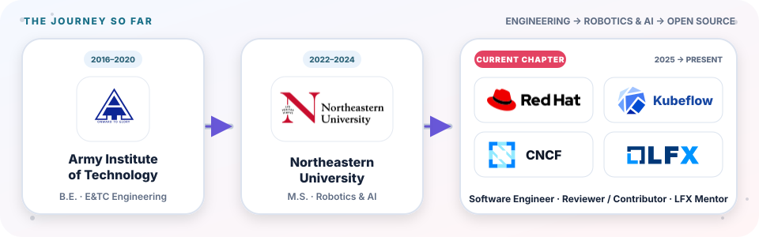

  <picture>
    <source media="(prefers-color-scheme: dark)" srcset="assets/career-journey-dark.svg">
    <source media="(prefers-color-scheme: light)" srcset="assets/career-journey-light.svg">
    
  </picture>

<h1 align="center">Rishabh Singh</h1>

<strong>Production AI infrastructure · Cloud-native data systems · Robotics & autonomous perception</strong>

  <a href="https://roburishabh.com/">Website</a> ·
  <a href="https://www.linkedin.com/in/roburishabh/">LinkedIn</a> ·
  <a href="mailto:roburishabh@outlook.com">Email</a> ·
  <a href="https://developers.redhat.com/author/rishabh-singh-ai">Red Hat Developer</a> ·
  <a href="https://medium.com/@RobuRishabh">Writing</a> ·
  <a href="https://sessionize.com/roburishabh/">Speaker profile</a>

I am a Software Engineer at **Red Hat AI**, building production data-processing infrastructure on Kubernetes and OpenShift. I work across Apache Spark, Kubeflow, distributed document processing, secure multi-tenant operators, and observability.

An M.S. in Robotics & AI and hands-on work in LiDAR, computer vision, autonomous systems, and GPS/IMU sensor fusion give me a robotics foundation for designing observable, failure-aware systems.

## Open-source contributions

I am a reviewer for the Kubeflow Spark Operator, contributing code, design, and reviews across deployment, reliability, security, multi-tenancy, and scheduling.

Starting with making Kustomize a complete, first-class deployment method alongside Helm, I built and validated the deployment path with the same Go E2E suite and added semantic drift checks to keep both packaging methods aligned. From there, I tightened least-privilege RBAC, hardened controller-runtime caches against memory-exhaustion failures, introduced namespace-scoped webhook controls for multi-tenant clusters, and improved Kubernetes Event reliability.

At Red Hat AI, I extended that work into OpenShift AI and Open Data Hub by moving Spark Operator integration to an out-of-tree module, adding resilience and E2E coverage, and building configurable namespace scope, Prometheus access, and operator/webhook NetworkPolicies. My current upstream work focuses on Kubernetes-native workload-aware scheduling, reliable events and observability, and a stronger Spark/Kubeflow developer experience.

**Explore my ongoing open-source work:** [PRs I have opened](https://github.com/search?q=is%3Apr+author%3ARobuRishabh&type=pullrequests&s=updated&o=desc) · [PRs I have reviewed](https://github.com/search?q=is%3Apr+reviewed-by%3ARobuRishabh&type=pullrequests&s=updated&o=desc)

## Kubeflow SDK and community

I help shape SparkClient's production API through design review and community work. I am also a **CNCF LFX mentor** for [Evolving SparkClient into Kubeflow's Unified Data Processing Layer](https://github.com/cncf/mentoring/issues/1975)—extending the path from raw data to trained models with observability, scheduled and streaming execution, and Spark-to-Trainer workflows.

## Focused stack

**Programming:** Go, Python, C++, JavaScript, SQL, MATLAB 
**Cloud-native + MLOps:** Kubernetes, OpenShift, Kubeflow, Docker, Helm, Kustomize, MLflow, GitHub Actions, AWS SageMaker, Amazon Bedrock, Azure OpenAI 
**Data, ML + perception:** Apache Spark, PyTorch, TensorFlow, scikit-learn, Pandas, NumPy, OpenCV, Point Cloud Library (PCL), Docling, LiDAR, sensor fusion 
**Systems + tooling:** Kubernetes Operators, controller-runtime, FastAPI, REST APIs, PostgreSQL, Git, Linux, Prometheus, Selenium, E2E/integration testing

**Current interests:** Kubernetes-native workload scheduling, secure multi-tenant AI platforms, observable distributed data processing, Spark/Kubeflow developer experience, and perception systems that combine geometry with learned models.

## Writing, speaking, and community

- Co-authored **[5 anti-patterns that cause Kubernetes operator vulnerabilities](https://developers.redhat.com/articles/2026/07/06/5-anti-patterns-cause-kubernetes-operator-vulnerabilities)** and **[Protect your Kubernetes Operator from OOMKill](https://developers.redhat.com/articles/2026/06/01/protect-your-kubernetes-operator-oomkill)** for Red Hat Developer, turning upstream cache hardening and broader controller audits into practical production guidance.
- Write about [distributed Docling + Spark](https://medium.com/@RobuRishabh/distributed-document-structuring-with-docling-and-spark-2337b16d23cd), ML, computer vision, and system design on [Medium](https://medium.com/@RobuRishabh).
- Mentor contributors through [CNCF LFX and the Kubeflow community](https://mentorship.lfx.linuxfoundation.org/project/01d5da81-e5d6-4693-920c-e0e6f4fbc9a8); find my [speaker profile](https://sessionize.com/roburishabh/) and [technical videos](https://www.youtube.com/@RobuRishabh) online.

## Let's connect

If you are working on cloud-native AI, distributed data processing, or autonomous systems, reach me through [LinkedIn](https://www.linkedin.com/in/roburishabh/) or [email](mailto:roburishabh@outlook.com).
